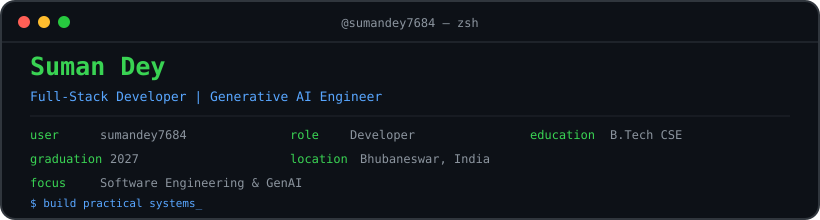
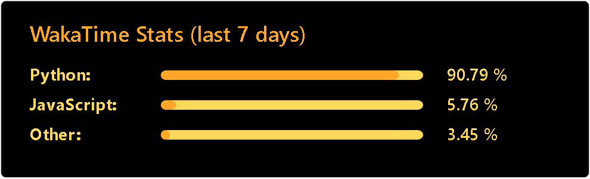

  

## If you're here, you're probably looking for my work

### [AstraDB](https://github.com/sumandey7684/AstraDB)

C++17 vector database and RAG engine built for fast semantic retrieval.

- HNSW, KD-Tree, and brute-force similarity search
- REST API integration and PCA visualization
- Ollama support for local embeddings and LLMs

<b>C++17</b> · HNSW · KD-Tree · RAG · Ollama

### [DeepTrace](https://github.com/sumandey7684/Deeptrace)

Offline Deep Packet Inspection engine for PCAP analysis and protocol identification.

- Directional 5-tuple hash-based load balancing
- Fast-path packet processing
- HTTP, HTTPS/TLS, and DNS detection
- FastAPI backend and React dashboard

<b>C++</b> · FastAPI · React · Vite · Networking

### [MeshPay](https://github.com/sumandey7684/MeshPay)

Offline-first UPI payment simulation focused on secure peer-to-peer transactions.

- RSA-OAEP and AES-256-GCM encryption
- SHA-256-based idempotency
- Concurrent transactions and bridge synchronization
- Optimistic locking

<b>Java 17</b> · Spring Boot 3 · H2 · Cryptography

## A little about me

- Final-year B.Tech CSE student at Trident Academy of Technology, BPUT (2027).
- Full-Stack Developer and Generative AI Engineer focused on building practical products.
- AI/ML Intern at MindBrain Innovation, working on multi-agent systems, MCP, and RAG pipelines.
- Experienced with React, Node.js, Python, Java, C++, and modern AI/LLM frameworks.
- Interested in software engineering, backend systems, and Generative AI.

> **700+ LeetCode problems solved. 1384 contest rating.**

## GitHub

  

<b>Stats Snapshot</b> · Last updated: 2026-11-17

  

  

  

  

  

  
  
  
  

