<picture>
<source media="(prefers-color-scheme: dark)" srcset="./cards/title-dark.svg">
<source media="(prefers-color-scheme: light)" srcset="./cards/title-light.svg">

</picture>

<a href="https://github.com/sumandey7684">GitHub</a>

